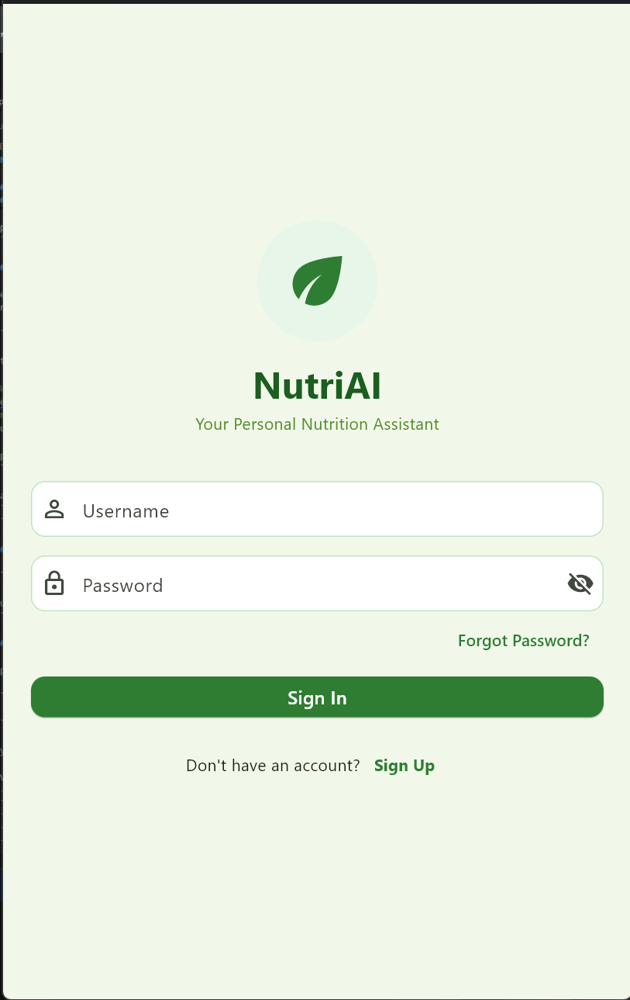
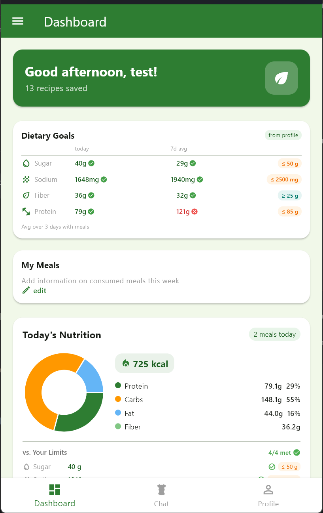
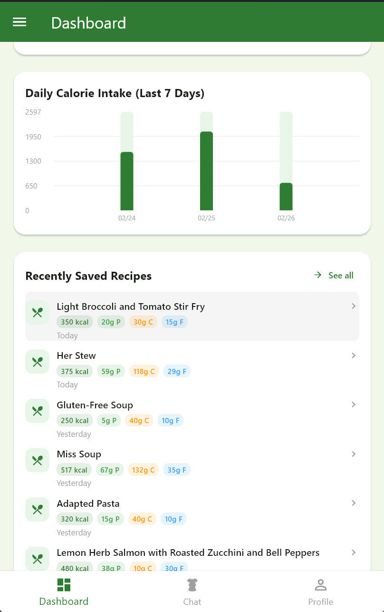
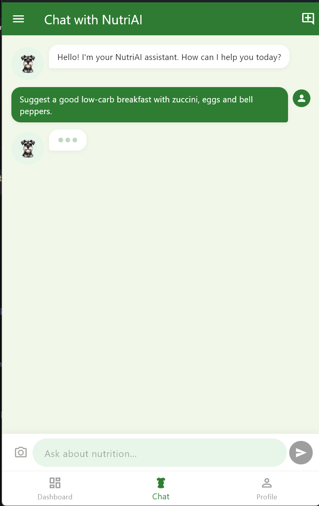
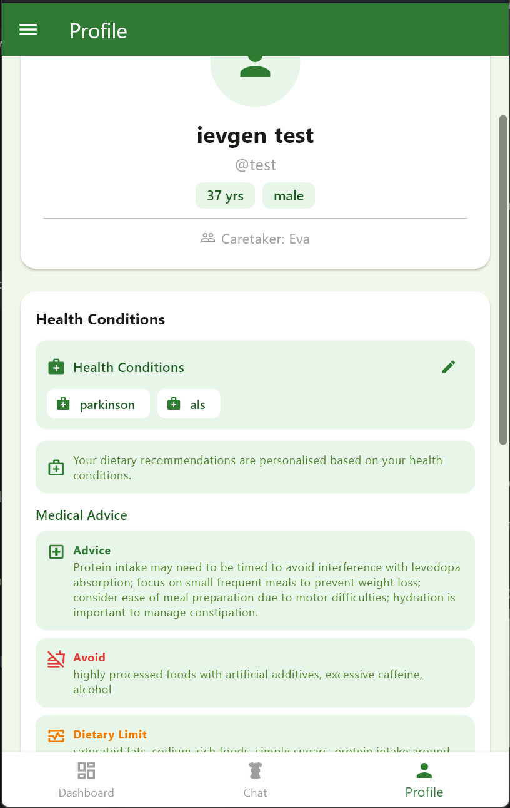

# NutriAI

**AI recipe agent for your personal diet.**

A personalized nutrition and recipe recommendation system powered by LLM, RAG, and computer vision. The system understands user health conditions, dietary restrictions, and daily nutrition budgets. It recommends safe recipes, detects food ingredients from photos, tracks daily nutrition, and holds natural conversations through a chat interface.

---

## Demo

<p align="center">
  
  
  
</p>
<p align="center">
  
  
</p>

A full walkthrough video and the slide deck live in `demo_material/` locally; they are not tracked in git (see [Repository weight](#repository-weight)).

---

## Table of Contents

**About the Project**

1. [Key Features](#key-features)
2. [Tech Stack](#tech-stack)
3. [High-Level Architecture](#high-level-architecture)
4. [Repository Structure](#repository-structure)

**Try It Yourself**

5. [Prerequisites and Setup](#prerequisites-and-setup)
6. [Level 1 -- Running Locally with Two Terminals](#level-1--running-locally-with-two-terminals)
7. [Level 2 -- Running with Docker](#level-2--running-with-docker)
8. [Level 3 -- Android APK (advanced)](#level-3--android-apk-advanced)

**Reference**

9. [Usage Overview](#usage-overview)
10. [Data and Vector Store Management](#data-and-vector-store-management)
11. [Testing and Quality](#testing-and-quality)
12. [Roadmap / Future Improvements](#roadmap--future-improvements)
13. [License](#license)

---

# About the Project

## Key Features

- **Live chat for recipe recommendations** -- Conversational agent considers health conditions, preferences, allergies, and dietary restrictions when suggesting recipes.
- **Ingredient extraction from images** -- Upload a photo and LLaVA (a vision-language model via Ollama) identifies the ingredients.
- **Dashboard** -- Track saved recipes, daily nutritional intake, and dietary goals.
- **Medical RAG** -- Automatic extraction of nutritional advice based on health conditions from medical literature (FAISS + BM25 hybrid retrieval).
- **Recipe RAG** -- Retrieval-augmented recipe search across nutrition and recipe datasets.
- **Safety filter** -- Every recommendation is checked against the user's health profile and nutrition limits before delivery.

---

## Tech Stack

| Layer | Technology |
|---|---|
| Backend API | FastAPI 0.109, Uvicorn, Pydantic v2 |
| LLM / Agent | LangGraph (ReAct agent), LangChain 0.3, Ollama (llama3.2), Groq, OpenAI (switchable) |
| Embeddings | HuggingFace (BAAI/bge-m3) |
| Retrieval | Hybrid FAISS (faiss-cpu) + BM25 (rank_bm25) via RRF, cross-encoder reranking |
| Image Detection | LLaVA vision-language model (via Ollama) |
| Database | SQLite (aiosqlite) |
| Auth | JWT (python-jose), bcrypt, passlib |
| Frontend | Flutter 3.x (Web, Android, Windows) |
| Document Ingestion | pypdf, unstructured |
| Containerization | Docker, Docker Compose |

---

## High-Level Architecture

```
┌──────────────────────────────────────────────────────────────────┐
│  Flutter App (Web / Android / Windows)                           │
│  Cross-platform client -- REST + WebSocket (port 9000)           │
└──────────────────┬───────────────────────────────────────────────┘
                   │ HTTP / WebSocket
                   │
┌──────────────────▼───────────────────────────────────────────────┐
│  FastAPI Backend  (src/)                                  :9000  │
│  ├─ LangGraph agent with 8 tools                                 │
│  ├─ Medical RAG + Recipe RAG  (FAISS + BM25 hybrid)              │
│  ├─ Safety filter, intent parser                                 │
│  └─ SQLite: users, recipes, nutrition, chat history              │
└──────────┬───────────────────────────────────────────────────────┘
           │
 ┌─────────▼───────────┐
 │  Ollama  :11434     │
 │  • llama3.2 (LLM)   │
 │  • llava (vision)   │
 │  • embeddings       │
 └─────────────────────┘
```

**Agent tools:** `search_recipes` . `save_recipe` . `show_recipe` . `analyze_image` . `nutrition_status` . `general_chat` . `safety_guard` . `crisis_support`

**Image detection:** LLaVA via Ollama -- a vision-language model that extracts ingredients from food photos.

---

## Repository Structure

```
nutrition-ai-assistant/
├── src/                        # FastAPI backend (hexagonal architecture)
│   ├── adapters/rest/          #   HTTP routes, WebSocket chat
│   ├── agent/                  #   LangGraph agent + 8 tools
│   ├── application/            #   Services, DTOs, session context
│   ├── domain/                 #   Entities, value objects, ports, exceptions
│   ├── infrastructure/         #   RAG, LLM, CNN adapters, SQLite repos, config
│   └── factory.py              #   Composition root -- all dependency wiring
├── app/
│   └── nutrition_ai_assistent/ # Flutter cross-platform client
├── data/                       # Demo recipe + nutrition CSVs
├── vector_databases/           # FAISS vector stores
├── db/                         # SQLite database (created at runtime)
├── uploads/                    # Shared image upload directory
├── docs/                       # Architecture guide, analysis
├── tests/                      # Automated tests (pytest) — run by CI
├── scripts/                    # Manual operator scripts (index rebuild, smoke checks)
├── training/                   # YOLO fine-tuning pipeline (not shipped in the image)
├── Dockerfile                  # Main API container
├── docker-compose.yml          # Orchestrates API + Ollama
├── run_api.py                  # Local dev entry (uvicorn, port 9000)
├── pyproject.toml              # Project metadata, dependencies (uv-managed)
├── uv.lock                     # Locked, reproducible dependency set
└── .env.example                # Environment variable template
```

---

# Try It Yourself

Pick the level that matches your comfort. Each level builds on the setup from the previous one, but you can jump straight to any level if you already have the prerequisites.

| Level | What you get | Time estimate | You need |
|---|---|---|---|
| **1 -- Local** | Full app in the browser (Web) | ~10 min | Python, Ollama, two terminals |
| **2 -- Docker** | One-command containerized stack | ~10 min | Docker only |
| **3 -- Android APK** | Install on a real phone | ~15 min | + Flutter SDK, device |

---

## Prerequisites and Setup

### Common Prerequisites

| Tool | Version | Needed for |
|---|---|---|
| Python | 3.11+ | Levels 1, 3 |
| uv | latest | Levels 1, 3 (Python env + deps) |
| Ollama | latest | Levels 1, 3 (local LLMs) |
| Docker + Docker Compose | latest | Level 2 |
| Flutter SDK | 3.x (SDK constraint ^3.9.2) | Level 3 |

### Environment Variables

All levels require a `.env` file. Create it once:

```bash
cp .env.example .env
```

At minimum, edit these:

| Variable | Default | Description |
|---|---|---|
| `JWT_SECRET` | `change-me-in-production` | Secret key for JWT tokens |
| `LLM_PROVIDER` | `ollama` | LLM backend: `ollama`, `groq`, or `openai` |
| `GROQ_API_KEY` | -- | Required when `LLM_PROVIDER=groq` |
| `OPENAI_API_KEY` | -- | Required when `LLM_PROVIDER=openai` |

<details>
<summary>Full environment variable reference</summary>

| Variable | Default | Description |
|---|---|---|
| `JWT_SECRET` | `change-me-in-production` | Secret key for JWT tokens |
| `JWT_EXPIRY_HOURS` | `24` | Token lifetime in hours |
| `LLM_PROVIDER` | `ollama` | LLM backend: `ollama`, `groq`, or `openai` |
| `LLM_MODEL_OLLAMA` | `llama3.2` | Model name when using Ollama |
| `LLM_MODEL_GROQ` | `llama-3.3-70b-versatile` | Model name when using Groq |
| `LLM_MODEL_OPENAI` | `gpt-4.1-mini` | Model name when using OpenAI |
| `GROQ_API_KEY` | -- | Required when `LLM_PROVIDER=groq` |
| `OPENAI_API_KEY` | -- | Required when `LLM_PROVIDER=openai` |
| `OLLAMA_BASE_URL` | `http://localhost:11434/` | Ollama server URL |
| `EMBEDDING_MODEL` | `sentence-transformers/all-mpnet-base-v2` | HuggingFace embedding model |
| `DB_PATH` | `users.db` | SQLite database path |
| `CNN_MODEL_PATH` | `llava` | LLaVA model name used for image ingredient detection |

</details>

### Backend Environment (Levels 1, 3)

Install [uv](https://docs.astral.sh/uv/getting-started/installation/), then from the project root:

```bash
uv sync
```

This creates `.venv/` and installs the locked dependency set from `uv.lock`. Run commands with `uv run` (e.g. `uv run python run_api.py`), or activate the venv directly:

```bash
source .venv/bin/activate      # macOS / Linux
.venv\Scripts\activate         # Windows
```

### Start Ollama (Levels 1, 3)

```bash
ollama serve
ollama pull llama3.2
ollama pull llava
```

---

## Level 1 -- Running Locally

**What:** Full application running in your browser with the Flutter web app, backed by the FastAPI server.

**Prerequisites:** Backend environment + Ollama running (see above), plus the Flutter SDK.

### Start the FastAPI Backend

```bash
# From project root
uv run python run_api.py
```

The API starts on `http://localhost:9000`. Verify: `curl http://localhost:9000/health`

### Run the Flutter Web App

```bash
cd app/nutrition_ai_assistent
flutter pub get
flutter run -d chrome
```

The app connects to `http://localhost:9000` by default. You can also run as a Windows desktop app:

```bash
flutter run -d windows
```

---

## Level 2 -- Running with Docker

**What:** One command spins up the entire backend stack (API + Ollama) in containers. Connect with the Flutter web app or just use the API directly.

**Prerequisites:** Docker and Docker Compose installed. No Python or Ollama installation needed on the host.

### 1. Prepare

```bash
cp .env.example .env
# Edit .env -- at minimum set JWT_SECRET and any API keys needed
```

### 2. Build and start

```bash
docker-compose up --build
```

This starts:

| Container | Port | Description |
|---|---|---|
| `nutriai-api` | 8000 | FastAPI backend |
| `nutriai-ollama` | 11434 | Ollama LLM server |

### 3. Pull Ollama models (first run only)

```bash
docker exec -it nutriai-ollama ollama pull llama3.2
docker exec -it nutriai-ollama ollama pull llava
```

### 4. Verify

```bash
curl http://localhost:8000/health    # -> {"status": "ok", "version": "0.2.0"}
```

### 5. Connect the Flutter web app (optional)

```bash
cd app/nutrition_ai_assistent
flutter pub get
flutter run -d chrome --dart-define=API_BASE_URL=http://localhost:8000
```

### 6. Stop

```bash
docker-compose down
```

### Deployment Notes

- The Docker API runs on port **8000** (Dockerfile CMD). The local dev entry (`run_api.py`) uses port **9000** with hot-reload.
- GPU support for Ollama is commented out in `docker-compose.yml` -- uncomment the `deploy.resources` block if an NVIDIA GPU is available.
- Data directories (`data/`, `data_test/`, `vector_databases/`) are mounted read-only. The `db/` and `uploads/` directories are writable bind mounts.
- Service URLs between containers use Docker internal DNS (`http://ollama:11434/`), set automatically via environment in `docker-compose.yml`.

---

## Level 3 -- Android APK (advanced)

**What:** Build an APK, install it on a real Android phone, and chat with the AI agent from your device.

**Prerequisites:** Everything from Level 1 running (backend + Ollama), plus Flutter SDK and a connected Android device or emulator.

### 1. Make sure the backend is reachable from the phone

Your phone must be able to reach the machine running the FastAPI backend. Options:

- **Same Wi-Fi network:** Use your machine's LAN IP (e.g., `192.168.1.x`).
- **Public IP / port forwarding:** Use your public IP.

### 2. Build the APK

```bash
cd app/nutrition_ai_assistent
flutter pub get
flutter build apk --dart-define=API_BASE_URL=http://<YOUR_IP>:9000
```

The APK is generated at `build/app/outputs/flutter-apk/app-release.apk`.

### 3. Install on device

Transfer the APK to your phone and install it, or use:

```bash
flutter install
```

### Alternative: Run directly on a connected device

```bash
# Android emulator
flutter run --dart-define=API_BASE_URL=http://10.0.2.2:9000

# Physical device over USB (same LAN)
flutter run --dart-define=API_BASE_URL=http://<YOUR_LAN_IP>:9000
```

A `dart_defines/local.json.example` template is provided for reference.

---

# Reference

## Usage Overview

### Chat-based Recipe Recommendations

1. Register and log in via the Flutter app.
2. Set up your health profile -- conditions, allergies, dietary restrictions, daily nutrition goals.
3. Ask for recipe suggestions in natural language.
4. The agent parses your intent, queries the Recipe RAG and Medical RAG, applies the safety filter against your profile, and returns tailored recommendations.
5. Save recipes you like; the dashboard tracks your daily nutritional intake.

### Image-based Ingredient Extraction

1. Upload a food photo through the Flutter app.
2. The image is sent to LLaVA via Ollama, which extracts the ingredients from the photo.
3. Detected ingredients are returned to the agent, which can then suggest recipes using those ingredients.

### Example Queries

```
I have type 2 diabetes and want to keep my meal low in refined carbs.
I currently have salmon, zucchini, bell peppers, lemon, Greek yogurt,
and almonds. Can you suggest a creative recipe?
```

---

## Data and Vector Store Management

- **Demo data included:** Small CSV datasets in `data/` (cleaned recipes, nutrition facts, healthy meals) are included for demonstration.
- **Private medical data not included:** Medical research PDFs used by the Medical RAG are private and not committed to this repository.
- **Vector stores:** Pre-built FAISS indexes live in `vector_databases/`. Manage them with `nutriai-index` — see [Vector index management](#vector-index-management) below.

### Repository weight

`notebooks/` (27 MB of exploratory research), the 36 MB demo video and the 4 MB
slide deck are no longer tracked. They remain on your disk and are gitignored.
The five README screenshots stay tracked — ~340 KB total, and the page needs
them to render on GitHub.

**This does not shrink an existing clone.** Git history still contains every
byte, so `.git` stays around 280 MB and `git clone` is no faster. Actually
removing them needs a history rewrite (`git filter-repo`), which changes every
commit hash and forces all 6 contributors to re-clone. That is a coordinated
decision, not a refactor, so it is deliberately left undone here.

If you decide to do it, the demo video and the 26 MB `dat_recipe_rag.ipynb`
account for most of the weight, and GitHub Releases is the natural home for the
video.

### Nutrition facts are a table, not a vector index

Food composition lives in the `nutrition_facts` SQL table (8,789 foods, 74
nutrients each), seeded automatically from `data/cleaned_nutrition.csv` on first
startup. It replaced a 36 MB FAISS index that embedded each row as ~25 lines of
near-identical template — where the only token distinguishing one food from
another was its name, and nothing ever filtered on the typed values.

The agent's `lookup_nutrition` tool queries it, so "how much protein is in
cornstarch" returns the exact row instead of the model's recollection, and
"foods highest in iron" is an `ORDER BY` rather than an approximate
nearest-neighbour search.

**Name matching is lexical, not semantic.** FTS5 matches words and prefixes:
`corn` finds Cornstarch, `thyme` finds "Spices, dried, thyme". It does *not*
handle synonyms or typos — `cornflour` finds nothing, because no lexical index
relates it to `Cornstarch`. When the match isn't exact the tool says so and
lists alternatives, rather than silently reporting the wrong food's macros. If
synonym handling turns out to matter, the cheap fix is a small synonym table,
not reintroducing embeddings.

Units are stripped and normalised per column at load, with the canonical unit
recorded in `nutrition_facts_units`. Values whose unit can't be converted
(7 rows store vitamin A in mcg where the column is IU, and that conversion
depends on the compound) are stored as NULL rather than as a confident wrong
number.

### Vector index management

```bash
uv run nutriai-index inspect                      # provenance + is it current?
uv run nutriai-index build                        # build anything missing
uv run nutriai-index rebuild --target medical     # force a full re-embed
uv run nutriai-index add --target medical a.pdf   # append without rebuilding
```

Run these on the host: docker-compose mounts `vector_databases/` read-only, and
the app now fails fast with a clear message rather than attempting a write there.

Each index carries an `index_meta.json` recording the embedding model, its
dimension, chunk settings, document count, and a SHA-256 of every source file.
**The app refuses to load an index whose embedding model or chunking no longer
matches the running config**, because a same-dimension model swap (`bge-m3` →
another 1024-d model) would otherwise load cleanly and return near-random
results. Changed *source data* is reported by `inspect` as advisory — the index
still loads, it's just behind.

Indexes built before this existed have no sidecar; they load with a warning
until you run `rebuild` once to stamp them.

Chunking is configurable via `RAG_CHUNK_SIZE` / `RAG_CHUNK_OVERLAP` (medical
corpus only — the recipe corpus is one document per CSV row and is not split).
The default of 300/50 is preserved from before so upgrading doesn't force a
rebuild, but ~800/150 is a better starting point: 300 characters is roughly 70
tokens and splits dosage guidance mid-sentence. Changing it requires a rebuild,
which the app will tell you about.
- The system supports dynamically updating or extending vector stores with new data without restarting the application.

---

## Testing and Quality

### Automated tests

```bash
uv run pytest tests/ -q          # Python
cd app/nutrition_ai_assistent && flutter test   # Flutter
```

CI runs these on every push and pull request via two workflows with path
filters, so a Dart change doesn't trigger the Python jobs and vice versa:

| Workflow | Jobs |
|---|---|
| `.github/workflows/python.yml` | ruff + lockfile check, pytest, Docker build (on push) |
| `.github/workflows/flutter.yml` | `dart format` check, `flutter analyze`, `flutter test`, web build (on push) |

### Manual scripts

`scripts/` holds operator scripts for rebuilding vector indexes and smoke-checking
components against a live Ollama. They print results for a human to read and
assert nothing — see [`scripts/README.md`](scripts/README.md).

```bash
uv run python scripts/rebuild_indexes.py   # full index rebuild
uv run python scripts/chat_repl.py         # interactive agent chat
```

---

## Roadmap / Future Improvements

- Smarter per-meal nutrition distribution (currently uses a 1/3 daily budget heuristic).
- Graduated severity levels for nutrition limit warnings.
- Timezone-aware timestamp handling improvements.
- Tighten CORS `allowed_origins` for production deployment.
- GPU acceleration configuration for Ollama in Docker.
- Add unit tests with coverage reporting.
- CI/CD pipeline automation.

---

## License

This project is licensed under the [MIT License](LICENSE).
